# 慢时光 · 宠物经营小镇

环境依赖：**Python 3.10+**、**Pygame 2.6.1+**。唯一第三方依赖是 `pygame`；`sqlite3`、`dataclasses`、`unittest` 均为 Python 内置模块，不需要数据库服务。

安装命令：

```powershell
python -m pip install -r requirements.txt
```

启动方式（在本项目目录执行）：

```powershell
python main.py
```

首次运行自动在项目根目录创建 `manor.db`。无需图片资源：庭院、宠物与图标全部由代码程序化绘制成圆润的伪 3D 黏土风；Windows 自动使用系统中文字体。其他系统如无中文字体，可放一个中文字体文件到 `assets/font.ttf`。

建议独立虚拟环境：

```powershell
python -m venv .venv
.venv\Scripts\python -m pip install -r requirements.txt
.venv\Scripts\python main.py
```

本次开发环境已将 Pygame 安装到项目内的 `.runtime`，当前目录可直接 `python main.py`。若当前解释器（如虚拟环境）已通过 pip 安装 pygame，则优先使用环境中的版本，`.runtime` 只在未安装时兜底——两者解释器版本不同时（如 `.runtime` 为 3.13、环境为 3.11），直接加载会导致 `No module named 'pygame.base'`。交付压缩包不包含该机器相关的安装目录，解压后按上面的安装命令准备依赖。

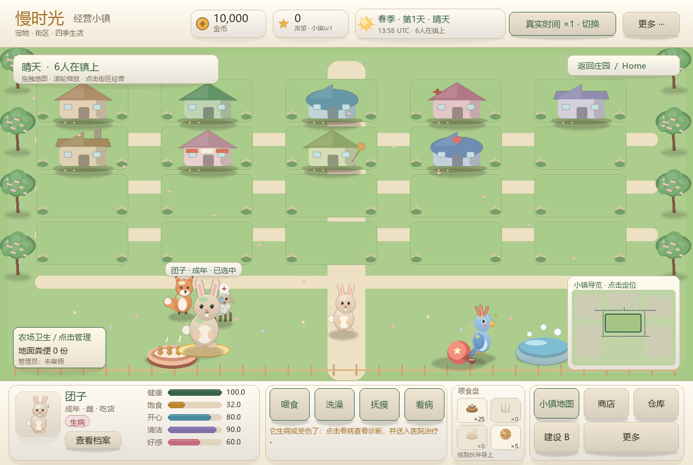

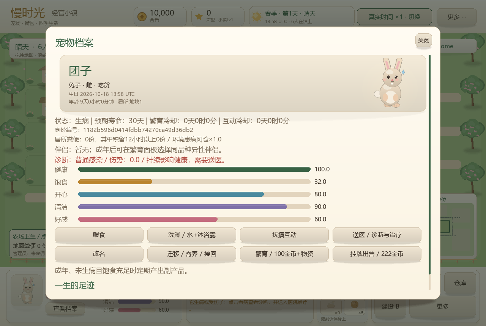

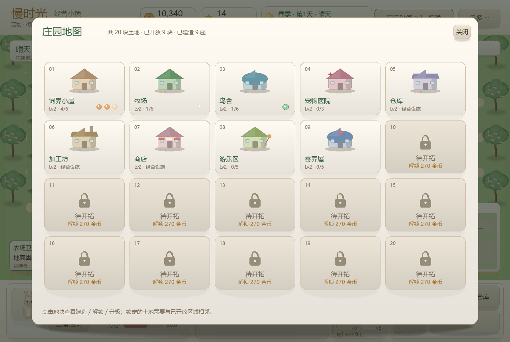

## 自由道路、房屋与交通（v5）

现在可在原有六街区世界里自由铺路、放置房屋并观察通车。原有宠物、繁育、医疗、寄养、卫生、天气、商店、订单与街区等级继续保留。

| 操作 | 用法 |
| --- | --- |
| 进入/退出建设 | 底栏「建设」、更多菜单、街区管理入口，或 `B` |
| 工具 | `1`道路、`2`住宅、`3`商业、`4`产业、`5`公共、`6`/`Del`拆除 |
| 铺路/拆路 | 左键拖出折线，松手整笔提交；快速拖动自动补齐四邻接格 |
| 镜头 | 建设中右键或中键拖动，滚轮缩放；普通模式保留左键/中键移图 |
| 建筑 | 右侧选风格和具体建筑，移动看幽灵，单击开始施工，`R`旋转；默认按临街边自动朝向 |
| 取消与撤销 | `Esc`取消笔画/幽灵，再次按Esc退出；`Ctrl+Z`撤销最近道路笔画并恢复费用（本次会话最多20笔） |
| 查看 | 悬停查看道路/建筑状态；点击玩家建筑打开详情，点击车辆显示轻量行程卡 |
| 覆层 | 工具条切换格线/地价；小地图同步显示道路和建筑，可点击定位 |

建设格为48世界像素，75×50格覆盖3600×2400世界。湖面、中央庄园及48像素安全边距、车站/固定地标不可占用；未开放街区仍需先支付原有开放费用。建筑占地不能重叠，至少一条边正交临街；斜角不算。资金不足时整笔拒绝，非法道路格跳过，所有中文原因都会显示。

道路有沥青街道10金币/格、青石街14金币/格、花园砖路12金币/格，均自动连接直路、转角、T字、十字与端头；不同风格可连通。同格同风格不重复收费，改铺收取新风格全价。自建道路拆除退**最初建设费用的50%并向下取整**，改铺费用不追加退款；新档/旧档赠送的114格默认道路原始费用为0，拆除不返金币。

### 15种玩家建筑

人口、商业、税收、吸引力与农田加成只在**完工且道路通达**时生效。工期使用游戏时间，离线也会完工。拆楼需确认：施工中退15%，完工退30%，均向下取整；占地立即释放。

| 风格 | 建筑 | 类别 | 占地 | 造价/金币 | 工期/游戏小时 | 效果（完工通路后） |
| --- | --- | --- | --- | ---: | ---: | --- |
| 古风 | 青瓦民居 | 住宅 | 2×2 | 260 | 4 | 人口+4，基础日税2 |
| 古风 | 木构茶楼 | 商业 | 2×2 | 380 | 6 | 消费+8%，吸引力+4，日税3 |
| 古风 | 飞檐客栈 | 商业 | 3×3 | 680 | 10 | 人口+6，消费+12%，吸引力+5，日税4 |
| 现代 | 玻璃公寓 | 住宅 | 3×3 | 520 | 8 | 人口+10，基础日税4 |
| 现代 | 街角咖啡 | 商业 | 2×2 | 420 | 5 | 消费+6%，吸引力+3，日税3 |
| 现代 | 云端写字楼 | 商业 | 3×3 | 900 | 14 | 人口+6，消费+10%，吸引力+4，日税7 |
| 田园 | 奶油小屋 | 住宅 | 2×2 | 240 | 4 | 人口+5，基础日税2 |
| 田园 | 花房商店 | 商业 | 2×2 | 360 | 5 | 消费+7%，吸引力+5，日税3 |
| 田园 | 风车粮仓 | 产业 | 3×2 | 480 | 8 | 人口+2，农田产量+15%，日税3 |
| 工业 | 红砖工坊 | 产业 | 3×2 | 620 | 10 | 日税6，附近地价−2 |
| 工业 | 铸铁仓库 | 产业 | 3×2 | 540 | 8 | 日税5，附近地价−2 |
| 工业 | 蒸汽厂房 | 产业 | 3×3 | 980 | 16 | 日税12，附近地价−4，吸引力−2 |
| 公共 | 口袋公园 | 公共 | 3×3 | 400 | 6 | 吸引力+6，附近地价+3 |
| 公共 | 小镇广场 | 公共 | 4×3 | 800 | 12 | 吸引力+12，附近地价+5 |
| 公共 | 公交站 | 公共 | 2×1 | 200 | 3 | 客流+10%，吸引力+1 |

街区入口必须通过道路连到庄园大门。拆断后会提示「道路中断」，对应消费、租金、公园/车站加成、农田产出与收获暂停；重接后恢复，断路期间不补发。人口容量减少时按小时更新迁出，重新接通后逐次恢复，仍受80人总上限约束。建筑基础日税受住宅地价影响，商业吸引力也受地价影响；倍率钳制75%～140%，整数金币/原料统一向下取整或按产量四舍五入，少量消费加成在低等级街区可能尚未形成1整金币差额。

汽车、公交、货车共享玩家道路寻路，右侧通行、转角平滑、跟车减速、交叉口预约让行，雨雪/夜间减速并亮灯。居民和游客沿路格边缘行走，保留雨伞、提包、点击档案；删路后改道或等待。车辆最多40辆，拥堵超过9秒可安全退场，交通是实时反馈，离线收益独立按拓扑和时间结算。

旧存档启动时自动升级至v5。SQLite变更前保存 `manor.pre-v5.db`，迁移失败回滚、隔离原档并尝试恢复备份；保留已有宠物、金币、关系、日志、街区等级、人口、天气与农田。只免费补默认路网，**不赠送玩家房屋，也不补发旧版离线税收**。原20块宠物地块及其ID保持不变。


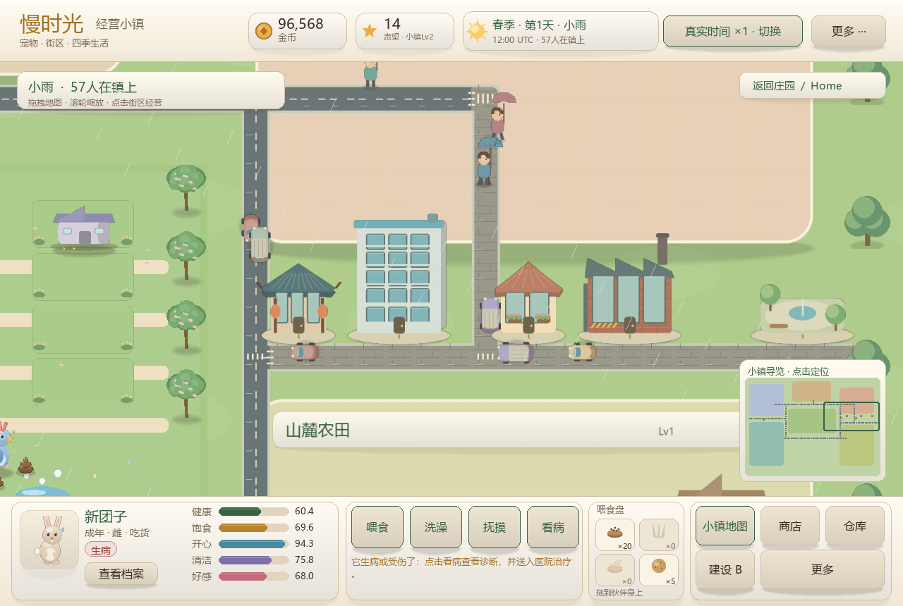

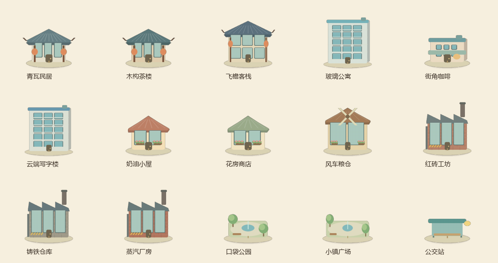

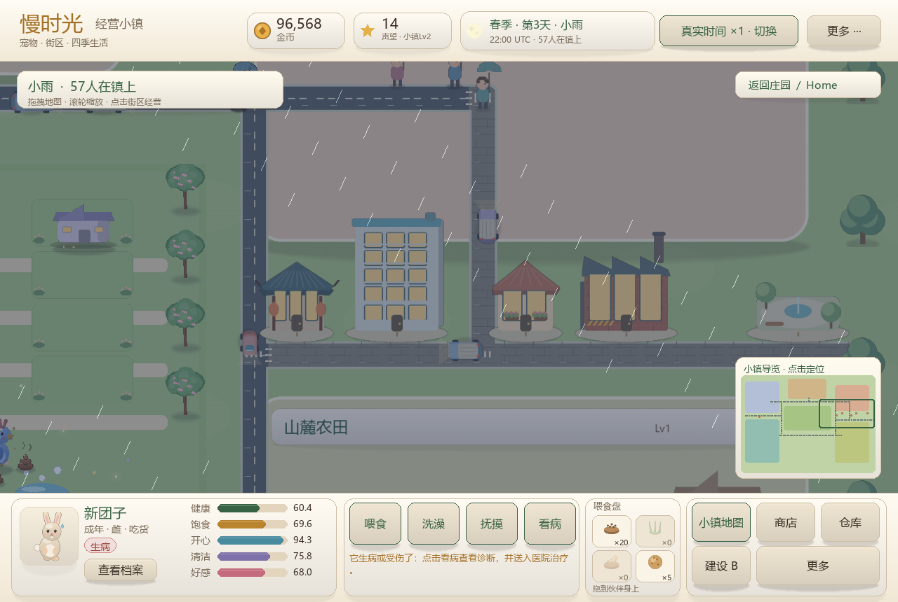

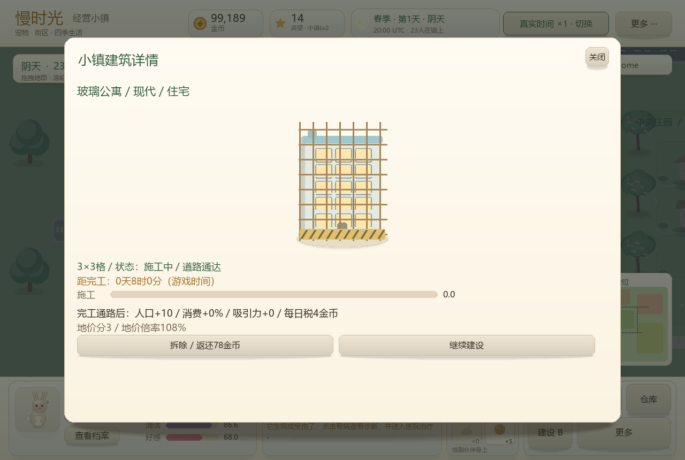

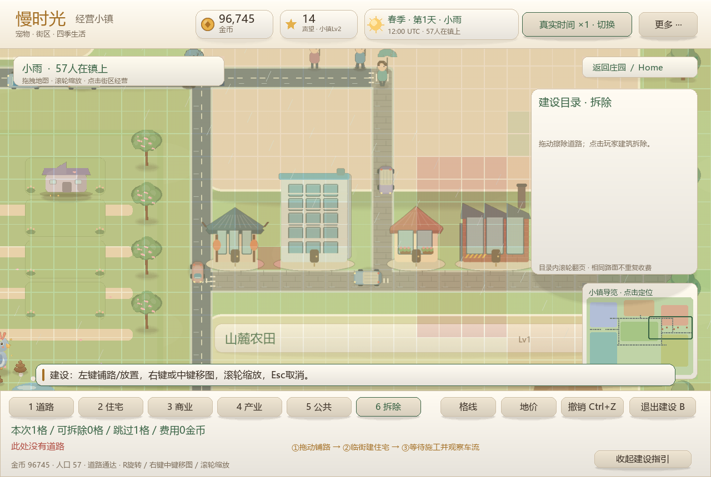

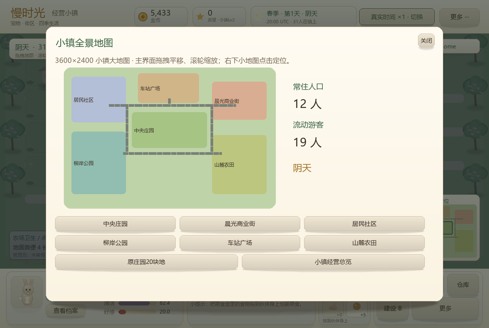

## 小镇大地图、天气与流动人口（v4，继续保留）

世界扩大至 **3600×2400**，中央庄园保留原有20块建造地块；外侧新增五个可付费开放、升级的经营街区。街区最高3级，点击场景或底栏「小镇地图」进入管理。现有存档自动升级，无需重新开始。

| 街区 | 首次开放费用 | 经营作用 |
| --- | ---: | --- |
| 中央庄园 | 已开放 | 原有宠物养成、繁育、医院、建筑、卫生与交易链路 |
| 晨光商业街 | 900金币 | 游客每次到访消费一次，每人收入为6×街区等级 |
| 居民社区 | 1100金币 | 每级增加8名居民容量，每名实际居民每游戏日支付2金币租金 |
| 柳岸公园 | 600金币 | 增加游客吸引力，并提升宠物互动的开心收益 |
| 车站广场 | 1400金币 | 增加每批到镇游客数量；客流还受声望与天气影响 |
| 山麓农田 | 750金币 | 每12游戏小时产出谷物、鲜草，天气和等级影响数量；12小时内手动收获入库 |

初始4名居民和2名游客。游客每2游戏小时到访，停留4小时后前往车站，离镇过渡3小时后移出工作集。居民白天活动、夜晚归家，画面中能看到行人沿道路走动、逛街与散步；点击行人查看身份、目的地和到离镇时间。人口上限80人，满员时新居民等待腾出位置。每笔消费、租金、作物、人口与到期时间均持久化，离线推进与重启不会重复领奖。

- **地图操作**：主场景按住鼠标左键或中键拖动，滚轮缩放至60%～140%；点击右下小地图定位。`Home`键或右上「返回庄园」回到宠物区域。单击宠物、双击/右键档案、拖拽喂食继续可用。
- **昼夜**：以界面标明的UTC模拟时间循环晨曦（05:00）、白昼（07:30）、黄昏（17:00）、夜晚（19:30）；夜晚街区窗户亮灯。
- **天气**：晴天、阴天、大风、小雨、暴雨、雨夹雪、降雪，每4游戏小时按季节权重更新。风线、雨滴、雪花、光照和行人雨伞随天气变化；左上天气卡可打开小镇面板查看下一时段预报。
- **天气影响**：客流和原有门票收入随天气变化；风雨雪提高户外宠物清洁衰减、附加少量健康损失，室内与寄养受到保护；农田收获量也随天气变化。
- **存档兼容**：v1/v2/v3自动经过v4字段迁移至当前v5，保留宠物、性别、关系、金币、原地块和日志。新增天气、人口与农田计时从升级时开始，不追溯计算旧版离线期间的小镇收益或天气伤害。

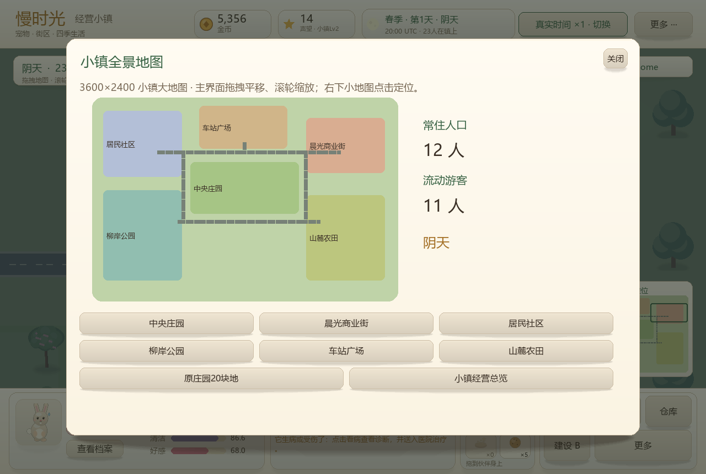

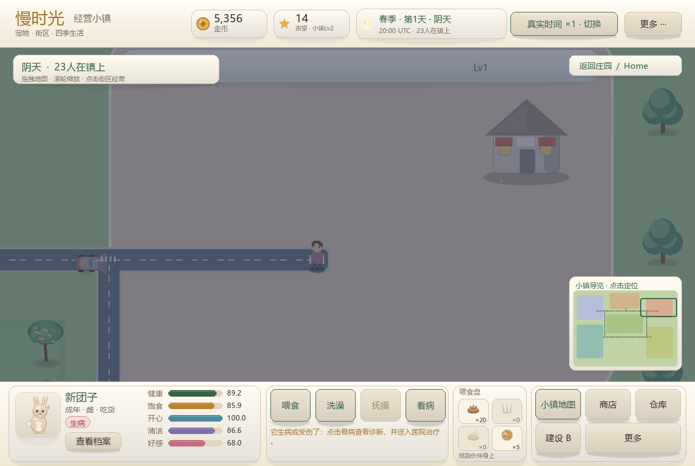

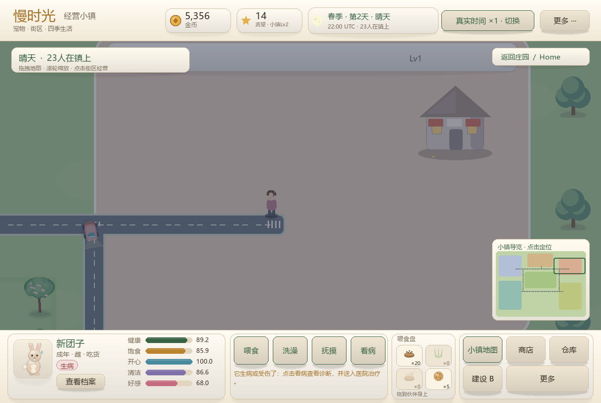

## 新增8种需要购买的宠物

重启游戏后打开底栏「商店」，新品种在目录最前方。金币不足或居所没有空位时购买按钮不可用；先建造/升级对应建筑再购买。新品种的首只需要付费购买，免费领养和流浪事件不会赠送；购买后的宠物可以正常成长、互动、繁育、寄养和出售。原存档可以继续使用。

| 宠物 | 幼崽售价（金币） | 适配居所 | 标准寿命（游戏天） | 成年产物 |
| --- | ---: | --- | ---: | --- |
| 猫咪 | 240 | 饲养小屋 | 40 | 猫毛 |
| 小狗 | 260 | 饲养小屋 | 42 | 犬毛 |
| 仓鼠 | 180 | 饲养小屋 | 24 | 软绒 |
| 刺猬 | 300 | 饲养小屋 | 32 | 森林果实 |
| 羊驼 | 420 | 牧场 | 48 | 羊驼绒 |
| 梅花鹿 | 480 | 牧场 | 50 | 林间香草 |
| 小鸭 | 200 | 鸟舍 | 28 | 鸭蛋 |
| 孔雀 | 600 | 鸟舍 | 46 | 孔雀羽 |

小鸭蛋170金币、孔雀蛋510金币，可即时孵化并有8%变异概率。其他6种新品种只出售幼崽。新品种产物可以出售，也会出现在NPC物资订单中。新增「庄园百兽册」成就：结识全部12个品种，奖励500金币与10声望；原有「四季伙伴」仍只要求最初四个品种。

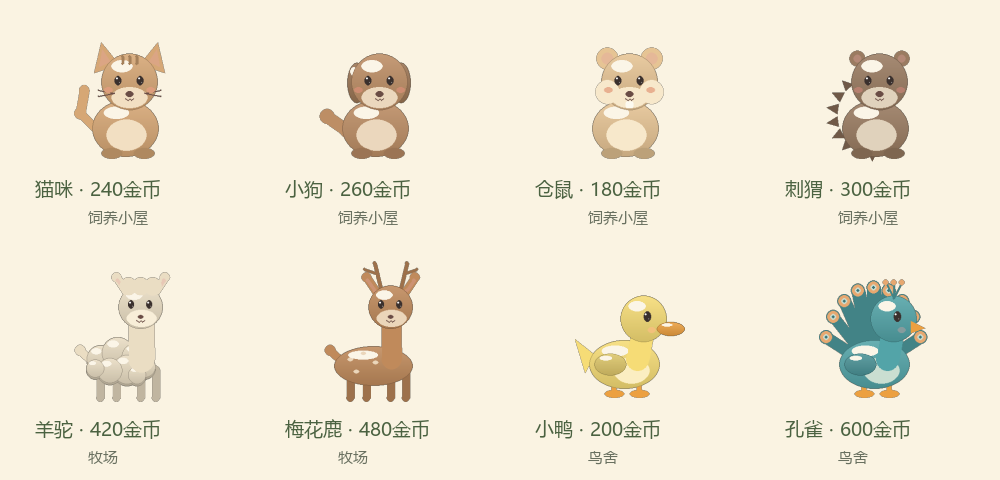

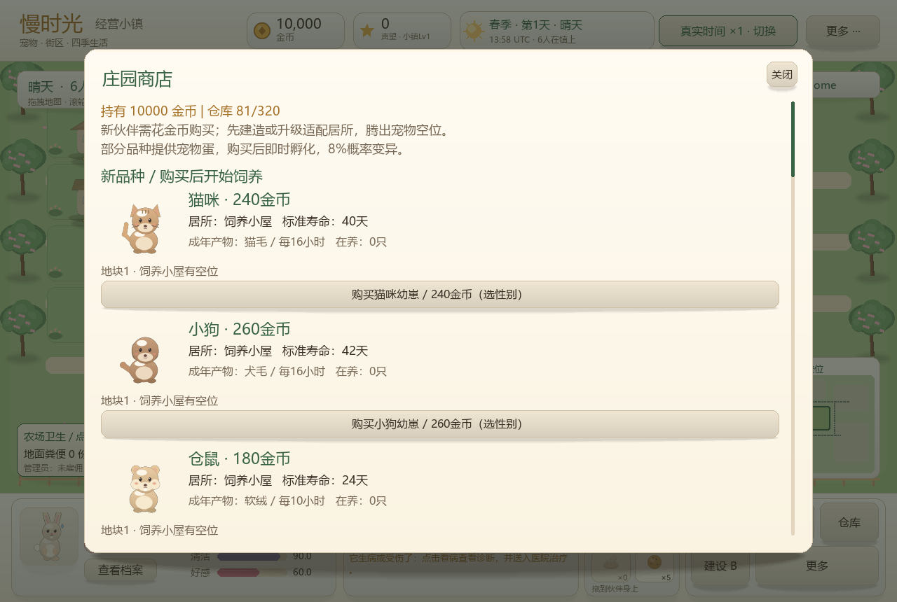

## 性别、伴侣、怀孕与医院

- 商店购买幼崽或宠物蛋时，先选择「雌性（母）」或「雄性（公）」，两种性别同价。现有和以后新增的品种共用性别字段与购买逻辑；出生、领养和事件宠物也都有永久性别。
- 在宠物档案打开「繁育」，可与同品种异性成年宠物结为伴侣。档案显示伴侣姓名、性别、所在居所或离世/离园状态，可点击跳转伴侣档案，也可解除关系。
- 双方同住一座非医院、非寄养的建筑，成年、无病无伤、健康≥50、好感≥35且冷却结束，才可手动尝试受孕。每次消耗100金币、3份饲料、2份清水，默认成功率85%；失败也消耗费用，6游戏小时后可重试。
- 成功后进入24游戏小时孕期，鸟类显示为「育卵」。这段时间不会立即生成幼崽，系统预留一个床位；到期自动分娩/孵化，准确记录出生时间、父母和性别。正常出生后父母冷却2游戏天。寄养同时暂停孕期；孕期不能出售、交付父母或解除关系；母体离世会终止孕期。
- 同居的非幼崽宠物可能打架，饥饿、低开心和拥挤会增加概率。双方都会损失健康、留下持续恶化的伤势；严重时可能离世。分开居住可避免相互冲突；医院和寄养屋内不会打架。
- 档案或底栏点击「看病」后，先「送入宠物医院」，再「接受治疗」。需有医院床位和药品，治疗每6游戏小时一次。普通感染通常能治好，重症可能治疗失败甚至救治无效；绝症无法治愈，只能舒缓照护并仍可能恶化死亡。死亡保留在纪念册，不可复活。

旧存档首次启动时自动从v1/v2/v3/v4迁移到v5：保留原有ID、性别、生日、金币与历史，补齐伴侣、孕期、医疗、排泄、小镇和道路字段。无需重新开档；原档中已出生的幼崽不会被重新变成孕期，旧版离线期间也不会追溯生成粪便。

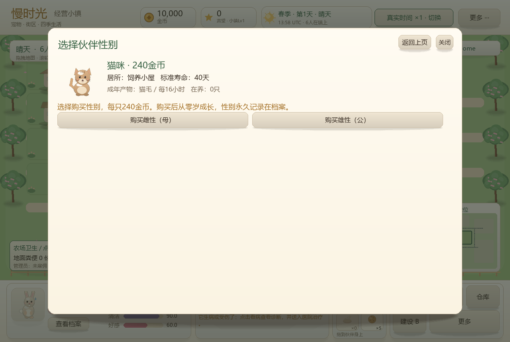


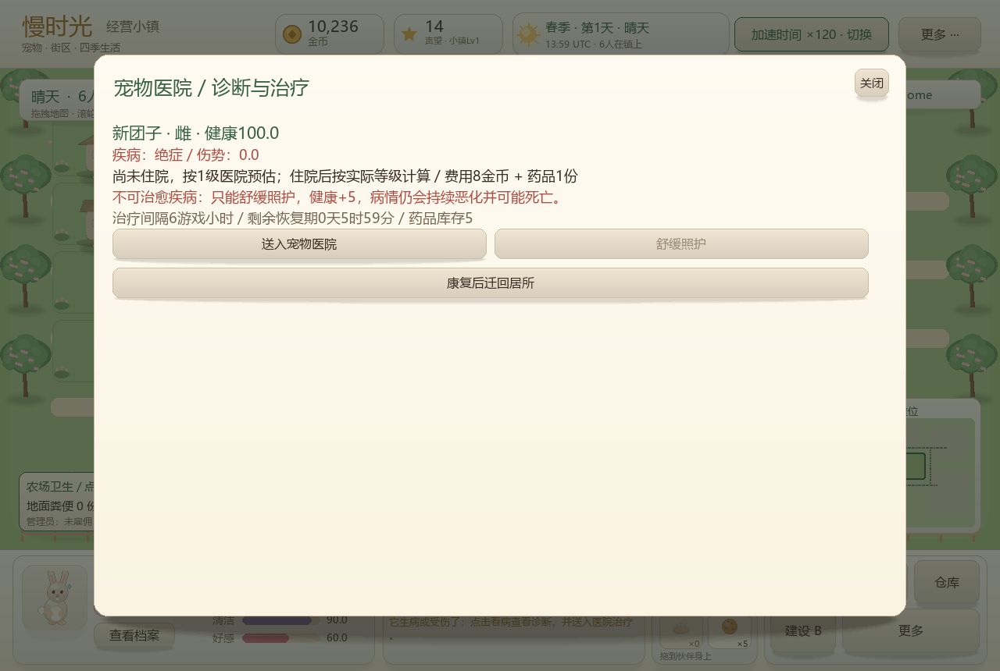

## 农场管理员、排泄与粪便销售

点击庭院左侧「农场卫生」告示牌、地面粪便，或「更多 → 农场卫生 / 管理员」进入管理面板。「今日庄园」和建筑详情也有卫生入口。

| 规则 | 默认数值与行为 |
| --- | --- |
| 排泄 | 每只在庄园正常生活的宠物每6游戏小时排泄1份，幼崽也会排泄；寄养暂停，离世/离园后停止 |
| 地面卫生 | 粪便增加所在居所的清洁衰减，积留12游戏小时后进一步提高疾病风险；不会污染别的居所 |
| 手动清理 | 可选择一堆、一个地块或全场收集入仓库，每份占1仓位，不消耗清水 |
| 管理员 | 招聘费180金币，每6游戏小时工资6金币，独立于原饲养员 |
| 自动清扫 | 管理员走向目标6游戏秒、挥扫帚8游戏秒，完成后收集入库；离线也照常工作 |
| 售价 | 每份粪便2金币，需要商店。可就地出售，不占仓容；也可收集后从仓库或卫生面板出售 |

管理员会在庭院中可见地走动、清扫；加速模式下也会保留短暂的完成动画。画面不修改资源，只有工单到期且入库成功后才移除地面粪便。满仓会等待腾空，工资不足会停工，需补足金币后重新雇佣；在职期间即使巡查或等待腾空，也会定时支付工资。管理员不喂食、不治疗、不自动出售，饲养员继续负责宠物日常喂食与清洁。

收集入库的粪便视为密封保存，可堆叠、不腐烂，不再污染地面，也不能用来喂食。清理环境不会自动治好已经生病的宠物，仍需送医。升级前的存档从升级时开始计算排泄，不会凭空补出旧版离线期间的粪便。

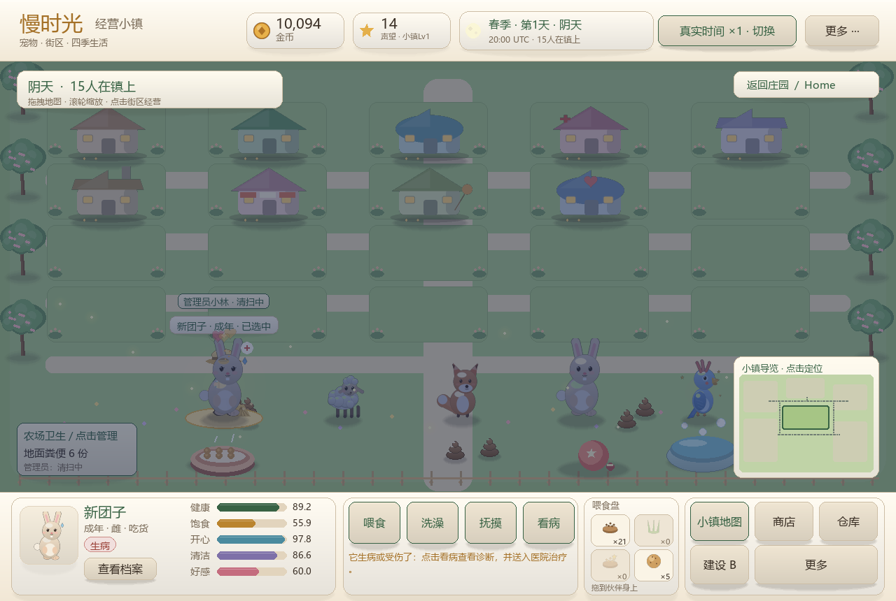

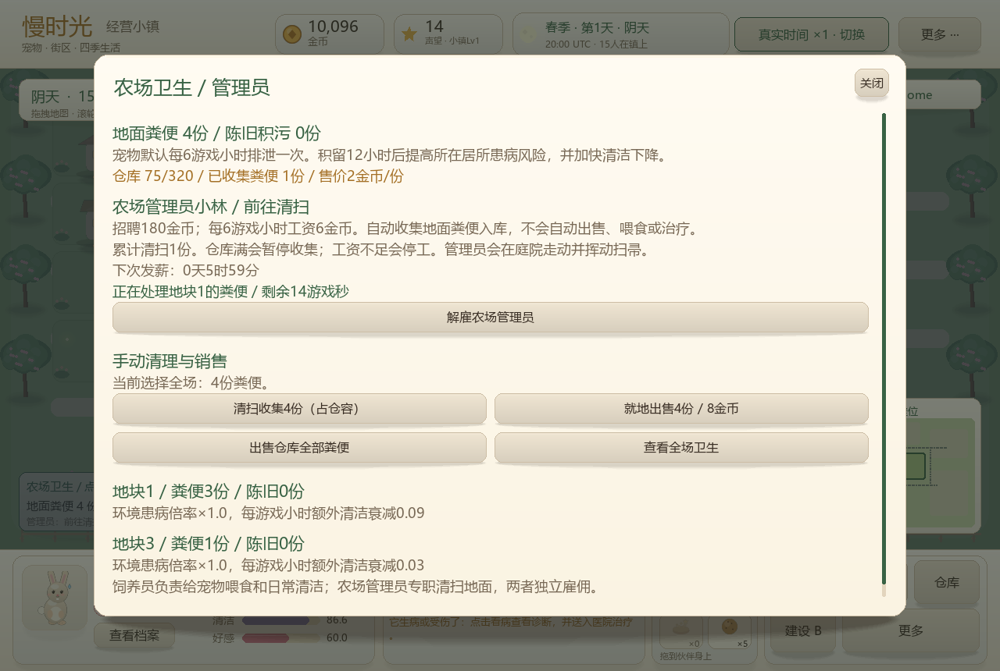

## 文件结构与独立源码

所有文件均为完整源文件，可以分别打开、编辑。另提供 `SOURCE_CODE.md`，按文件名分别用代码块收录全套 Python 源码。

| 文件 | 职责 |
| --- | --- |
| [main.py](main.py) | 启动、独立存档参数、无窗口启动验证 |
| [db.py](db.py) | 全部数据库读写、事务、结构与语义校验、备份恢复 |
| [game_config.py](game_config.py) | 寿命、衰减、价格、容量、配方、经济、事件、成就数值 |
| [pet.py](pet.py) | 独立宠物、精确年龄、分段积分衰减、生病、成长、死亡、生平 |
| [building.py](building.py) | 地块、建筑、升级价格与容量 |
| [inventory.py](inventory.py) | 批次、堆叠、仓容、到期优先消耗、腐烂 |
| [event.py](event.py) | 随机事件、文案、NPC订单生成 |
| [achievement.py](achievement.py) | 图鉴累计、成就条件和一次性奖励 |
| [game.py](game.py) | 全局时钟、离线调度、所有玩法操作与事务协调 |
| [weather.py](weather.py) | 持久化天气、独立确定性随机源、UTC昼夜与户外影响 |
| [town.py](town.py) | 六大街区、常住/流动人口、消费、租金、农田与精确调度 |
| [camera.py](camera.py) | 不依赖Pygame的世界/屏幕坐标转换、平移、缩放与边界 |
| [town_view.py](town_view.py) | 小镇场景、道路行人、天气特效、夜间灯光、摄像机与小地图 |
| [town_grid.py](town_grid.py) | 48像素格、保护地形、默认道路、16邻接遮罩、连通分量与缓存寻路 |
| [town_catalog.py](town_catalog.py) | 三种道路、15种建筑、车流、地价、退款和经济常量 |
| [town_build.py](town_build.py) | 共享预览/放置校验、道路原子笔画、撤销、施工、税收和收益聚合 |
| [town_art.py](town_art.py) | 道路chunk、真正2倍超采样建筑、车辆与人物缓存精灵 |
| [traffic.py](traffic.py) | 右侧车道、Bezier转向、跟车/让行、断路重规划与人行道 |
| [build_ui.py](build_ui.py) | 非模态建设目录、键鼠工具、幽灵、费用、格线与地价覆层 |
| [social.py](social.py) | 双向伴侣关系、同居受孕、孕期/离线分娩、床位预留与打架 |
| [medical.py](medical.py) | 住院、治疗概率、失败/死亡、绝症舒缓照护与恢复期 |
| [sanitation.py](sanitation.py) | 排泄、环境风险、管理员工单/工资、手动清扫和粪便销售 |
| [sanitation_view.py](sanitation_view.py) | 地面粪便、管理员走路/扫帚/完成动画与卫生告示牌 |
| [ui.py](ui.py) | 暖阳奶油主题、按钮、弹窗、进度条、中文输入框、滚动日志与文本缓存 |
| [art.py](art.py) | 程序化美术工具：渐变、软阴影、黏土面板、小屋与图标、LRU 缓存 |
| [pet_art.py](pet_art.py) | 十二物种 × 四成长阶段的伪 3D 宠物立绘、动画状态机与帧缓存 |
| [courtyard.py](courtyard.py) | 2.5D 庭院、四季/昼夜配色、小屋与场景物件、粒子、深度排序与命中检测 |
| [hud.py](hud.py) | 顶部 HUD、底部宠物卡/动作栏/喂食盘/导航、更多菜单、庄园地图弹窗 |
| [interface.py](interface.py) | 界面控制层：绘制顺序、输入路由、经营弹窗、拖拽喂食与光标 |
| [assets/](assets/) | 可选字体资源 |
| [tests/test_game.py](tests/test_game.py) | 37项核心逻辑、经济链路和异常恢复测试 |
| [tests/test_catalog.py](tests/test_catalog.py) | 11项新品种购买、免费来源限制、繁育、交易、寄养和兼容性测试 |
| [tests/test_social_medical.py](tests/test_social_medical.py) | 26项性别、伴侣、孕期、打架、医疗、迁移与分娩回滚测试 |
| [tests/test_sanitation.py](tests/test_sanitation.py) | 23项排泄、污染疾病、管理员、工资、清扫/销售、回滚与v2迁移测试 |
| [tests/test_town_weather.py](tests/test_town_weather.py) | 19项天气、人口、街区经济、农田、摄像机、迁移及回滚测试 |
| [tests/test_town_build.py](tests/test_town_build.py) | 29项格网、原子笔画、占地、施工、经济、迁移与坏档恢复测试 |
| [tests/test_traffic.py](tests/test_traffic.py) | 12项车道、转向、天气/数量、拆路安全、人行道与RNG隔离测试 |
| [tests/build_smoke.py](tests/build_smoke.py) | v5真实输入、15种建筑美术、关键截图与80人/40车压力采样 |
| [tests/ui_smoke.py](tests/ui_smoke.py) | 53种页面状态、912种宠物动画状态、28种天气/昼夜组合、大地图交互与原有操作 |
| [开发说明.md](开发说明.md) | 玩法、时间与存档设计、调参数入口、迭代方向 |
| [tools/package.py](tools/package.py) | 重新导出分文件源码汇总与可分发 ZIP |

自动产生的文件：`manor.db`、SQLite 的 `-wal` / `-shm` 文件、`manor.backup.db`、退出时导出的 `log.txt`。损坏档案被隔离为 `manor.db.damaged-时间编号`，保留原始数据以便排查。

## 开始游玩

1. 初始有3600金币、两只异性兔子、饲养小屋、仓库和商店，还有三块空地与基础物资。
2. 庭院里最多同时自由活动 5 只伙伴。单击宠物即可选为焦点并抚摸；连点两下或右键打开档案。底栏的「喂食 / 洗澡 / 抚摸 / 看病」会按库存与冷却显示可用状态。
3. 把喂食盘里的食物直接拖到宠物身上也能喂食；拖拽中按 Esc 或窗口失焦会安全取消。
4. 点击庭院里的小屋进入建筑管理，点「小镇地图」探索六大街区；其中「原庄园20块地」进入5×4建造网格。原地块解锁仍需与已开放区域相邻。
5. 初始为真实时间。右上角可切换120倍加速。普通兔子7.5游戏天成年，加速模式约90现实分钟；可以分多次游玩。
6. 同品种异性成年宠物，健康至少50、好感至少35且冷却结束，安排同居后可以尝试受孕。成功后等待24游戏小时分娩；每次尝试消耗100金币、3份普通饲料、2份清水。
7. 成年且未生病、饱食充足的宠物自动产出副产品。点击档案手动收取，再出售、加工或完成订单。
8. 建造牧场/鸟舍后购买绵羊/鹦鹉；狐狸适配饲养小屋。不同品种有独立寿命和产品。
9. 忙碌时，雇饲养员托管基础生存，或送进寄养屋让年龄和属性暂停。寄养入住所需40金币，接回免费。
10. 「更多」菜单汇总小镇经营、地图、名册、加工坊、订单、事件、图鉴、成就、回忆花园、日志、指南与「今日庄园」。拖动主场景探索街区，点击行人查看档案。

弹窗内部滚轮滚动，`PageUp` / `PageDown` 翻页，`Esc` 关闭弹窗或取消拖拽，`F1` 打开指南。单击宠物抚摸、双击或右键打开档案；点击食盆打开喂食页，点击浴盆洗澡，点击玩具互动。弹窗打开时，庭院继续渲染，时间继续流逝。中文改名使用操作系统输入法。

## 时间规则

- 所有存储时间均为 UTC Unix 时间戳；界面明确显示 UTC。加速模式中的日期是从真实 UTC 起点推进的**庄园模拟时间**。
- 真实模式：现实流逝1秒，庄园流逝1秒。加速模式：现实流逝1秒，庄园流逝120秒。**加速倍率在离线期间同样适用。**
- 切换模式先按原倍率结算到点击时刻，然后新倍率立即生效，不会追溯改变过去的年龄。
- 寄养保留原始生日，累计独立的暂停时长，年龄 = 结算时刻 − 出生时刻 − 寄养暂停时长。
- 退出、启动、每个经营操作都执行状态结算；运行期间每秒刷新，默认每10现实秒自动存档，每个经营操作即时提交。
- 不截断离线时差。长时间未上线可能导致物资过期、订单失效、疾病或离世。长期没空请先寄养并切回真实模式。
- 系统时钟回拨期间不倒扣年龄、不重复支付收益；时钟追平已记录的真实时间后继续推进。

## 已实现的经营系统

| 系统 | 实际行为 |
| --- | --- |
| 个体养成 | 唯一ID、雌雄、性格、生日、精确年龄、五属性、阶段、患病、最大寿命 |
| 沉浸界面 | 程序化伪 3D 庭院、四季与昼夜、同屏最多5只自由活动、黏土风 HUD 与弹窗、庄园地图 |
| 经营小镇 | 3600×2400世界、六大街区、付费开放与升级、消费/租金/农田、可见流动人口 |
| 天气与地图 | 七种天气、四段昼夜、季节权重、预报、户外影响、拖拽平移、鼠标锚点缩放、定位小地图 |
| 自由建设 | 三种路面、折线笔画、自动拼接、改铺/拆路/撤销、15种建筑、临街校验、施工/拆楼 |
| 交通与拓扑经济 | 汽车/公交/货车、路格人行道、右行/让行、街区及建筑断路暂停、地价、税收 |
| 交互 | 单击抚摸/双击档案、场景物件点击、拖拽喂食、多种食物效果、洗澡、看病、中文改名 |
| 繁育 | 选性别购买、异性伴侣、同居受孕、24小时孕期、床位预留、离线分娩、父母档案、8%变异 |
| 打架与医疗 | 同居冲突、双方受伤、持续伤害、住院治疗、概率失败/死亡、不可治愈疾病 |
| 寄养 | 自动暂停年龄与属性，接出后继续；保留原始出生时间 |
| 建筑 | 5×4地块、邻接解锁、9种建筑、容量、升级、拆除、不适配减益 |
| 仓库 | 堆叠与批次、总容量、先到期先消耗、鲜货→腐败物→消失、误喂致病 |
| 加工 | 谷物/水制作高级饲料，羊奶/鸟蛋/谷物制作特制零食 |
| 经济 | 幼崽/成宠挂牌即时成交、宠物蛋即时孵化、物资交易、副产品、游客、NPC订单 |
| 饲养员 | 招聘费、定时工资、喂食清洁、原料不足限制；不治疗、不涨好感、不收产品 |
| 农场卫生 | 宠物排泄、陈旧粪便致病风险、可见管理员、自动/手动清扫、地面及仓库销售 |
| 事件 | 8类利好/利空、多选项、资源或金币代价、超时自动选择、开园与定时触发 |
| 订单 | 物资和指定品种/年龄阶段宠物、截止时间、金币与声望奖励 |
| 收集 | 12品种图鉴、变异与寿终标记、9项成就、一次性奖励、离世和离园档案 |
| 季节 | 每7游戏天轮换，夏季更易脏，冬季户外额外健康损失 |
| 持久化 | SQLite事务、WAL、完整同步、语义校验、备份、损坏原档隔离恢复、永久日志 |

挂牌出售与宠物蛋孵化采用即时结算，无须等待外部买家或额外孵化队列。鲜货过期先转为可清理/可能误喂的腐败物，腐败物一天后消失。

## 验证命令

```powershell
python -m unittest discover -s tests -v
python tests/ui_smoke.py
python main.py --smoke --db .test-output/smoke.db
```

157项逻辑测试（原116项+新增41项）不依赖Pygame，使用独立临时数据库。UI测试保留53种原有页面、912种宠物动画状态、28种天气/昼夜组合和全部旧交互断言，并追加v5笔画、费用、撤销、目录、旋转、非法幽灵、施工详情、拆除确认、车辆卡片、地价、缓存及性能检查。UI/车辆/行人不消耗 `game.rng`。截图和性能JSON在 `.test-output`，不修改玩家默认存档。也可以自行指定另一份存档：

```powershell
python main.py --db my_other_manor.db
```

本项目的Conda环境可用以下等价命令：

```powershell
conda run -n Pet python -m unittest discover -s tests -v
conda run -n Pet python tests/ui_smoke.py
conda run -n Pet python main.py --smoke --db .test-output/smoke.db
```

性能采样方法与当前结果见 [开发说明](开发说明.md) 和 [原始JSON](docs/performance.json)。当前测试覆盖视口内实际80人、40车、5只宠物、345格道路、9栋已完工建筑，先预热40帧再测180帧的完整UI更新与绘制；不包含首次缓存创建、SQLite提交或真实帧率等待。硬件和窗口驱动会影响实测值。

实现取舍：默认道路沿原街区入口吸附格网，并绕开庄园安全边距；成排的不可交互装饰房屋缩减为固定地标，为玩家房屋留出空间。车辆与行人动画位置不入库，重启按当前人口/拓扑重建；拆掉行人脚下的道路时安全定位到最近剩余路格。当前没有物理碰撞、事故、桥梁施工、自由曲线道路；车辆行程与实时拥堵不决定离线收益。

## 打包源码

```powershell
python tools/package.py
```

生成 `SOURCE_CODE.md` 和 `pet_manor_source.zip`，不打包个人存档、运行环境和临时测试数据库。
